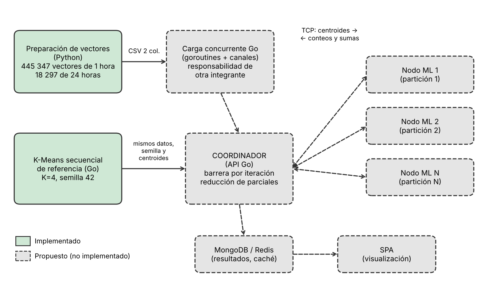
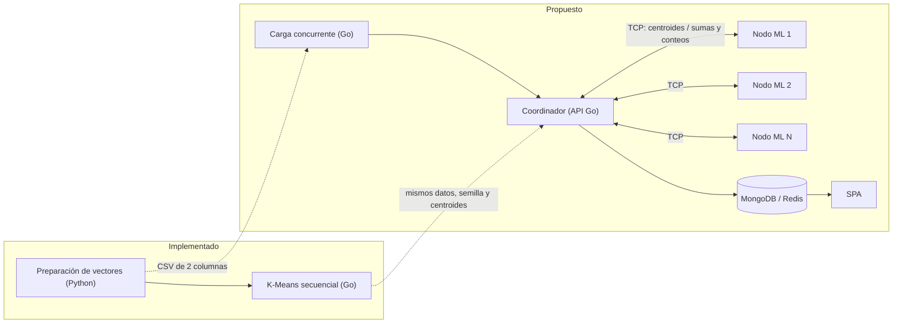
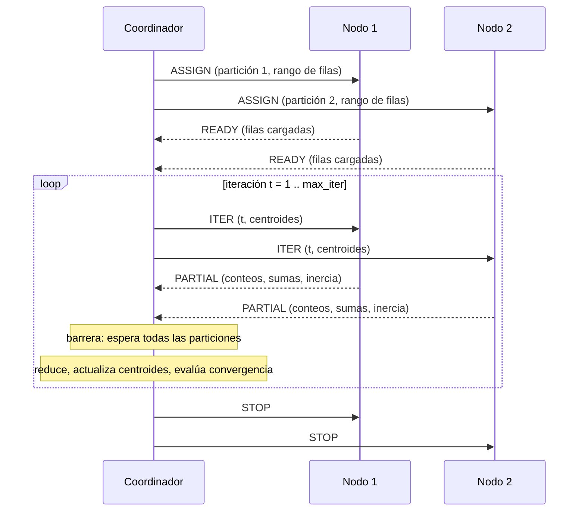
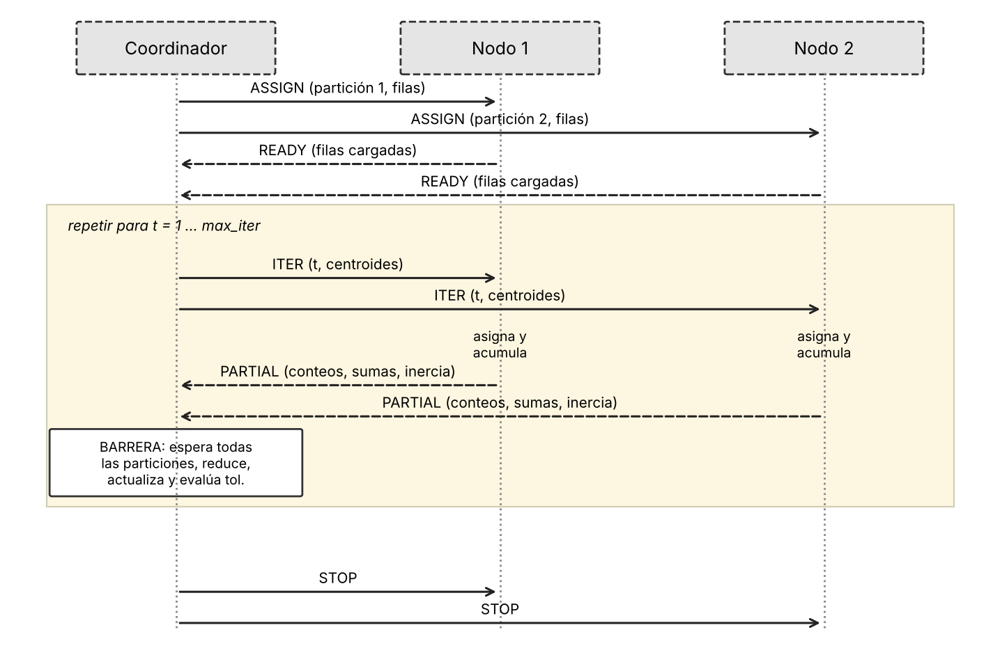

# Diseño del modelo ML distribuido

Este documento justifica el uso de K-Means sobre los vectores `[PM10, PM2.5]` y describe el diseño del cálculo distribuido. Separa lo **implementado** (preparación de vectores y referencia secuencial en Go) de lo **propuesto** (nodos, coordinador, API y bases de datos).

## 1. Justificación de K-Means y representación de entrada

### 1.1 Para qué sirve el agrupamiento en este proyecto

La pregunta del proyecto es cómo se distribuyen las concentraciones observadas de PM10 y PM2.5 entre los puntos y periodos disponibles y qué patrones pueden apoyar el monitoreo ambiental. Los registros de OEFA no traen una etiqueta que indique a qué "perfil de contaminación" pertenece cada observación, por lo que el problema es **no supervisado**. K-Means encaja porque agrupa observaciones con concentraciones semejantes y entrega, por cada grupo, un centroide interpretable: un par `[PM10, PM2.5]` en µg/m³ que resume el perfil típico del grupo.

El algoritmo también es adecuado para el objetivo del curso. Cada iteración se descompone en (a) un cálculo independiente por observación (asignarla al centroide más cercano) y (b) una reducción pequeña (sumas y conteos por clúster). Esa estructura permite repartir las observaciones en rangos, procesarlos en paralelo y combinar resultados parciales.

**Alcance del resultado.** Un clúster expresa similitud entre pares `[PM10, PM2.5]`. No es una categoría sanitaria, no define umbrales de alerta y no es una predicción. La predicción de concentraciones requiere un modelo y una validación temporal propios.

### 1.2 Observación y dimensiones

La observación del modelo es el vector `x = [PM10, PM2.5]`, en µg/m³, con `d = 2`. Proviene de la preparación de `Vectores.ipynb`: 463 644 pares completos, de los cuales 445 347 son de 1 hora y 18 297 de 24 horas. El archivo que consume el modelo contiene solo esas dos columnas (`features_1_hora.csv` y `features_24_horas.csv`). La ubicación, la fecha, la hora y el datum son metadatos: no forman parte del vector ni de la distancia.

En la implementación secuencial, los datos se cargan en `Dataset{Points [][]float64, N int, D int}` con `D = 2`. Los ceros numéricos son valores registrados y se conservan como observaciones válidas; el archivo de 1 hora contiene 16 437 vectores con ambas concentraciones en cero.

### 1.3 Distancia

Se usa la **distancia euclidiana al cuadrado**. Ambas dimensiones están en la misma unidad (µg/m³), por lo que la distancia tiene sentido físico. Además, la media aritmética es el punto que minimiza la suma de distancias euclidianas al cuadrado, de modo que el paso de actualización de centroides es coherente con la métrica. Se omite la raíz porque no cambia cuál centroide es el más cercano y ahorra cálculo en el bucle principal.

### 1.4 Periodo

El periodo del modelo distribuido es **1 hora** (445 347 vectores). Los vectores de 24 horas (18 297) corresponden a otra ventana de medición y **no se mezclan** con los horarios: tratarlos como equivalentes combinaría concentraciones obtenidas bajo intervalos distintos. La referencia secuencial se ejecutó además sobre 24 horas, de forma independiente, solo como comparación.

### 1.5 Escalado

La implementación actual **no escala** los datos. Así los centroides se leen directamente en µg/m³. El riesgo es que PM10, con mayor dispersión que PM2.5, pese más en la distancia; PM2.5 es además una fracción de PM10, por lo que ambas variables están relacionadas. No se ha evaluado todavía una estandarización (z-score). Si se adopta, debe calcularse una sola vez y aplicarse idéntica en la referencia, en la versión concurrente y en los nodos.

### 1.6 Parámetros de la referencia secuencial

| Parámetro | Valor | Observación |
| --- | --- | --- |
| Número de clústeres `K` | 4 | Valor fijado para la referencia. **No se ha seleccionado con un criterio** (por ejemplo, método del codo); queda pendiente. |
| Inicialización | `K` observaciones elegidas al azar sin reposición (`rng.Perm`) | Semilla fija `42`. No es k-means++. |
| Distancia | Euclidiana al cuadrado | Ver 1.3. |
| Escalado | Ninguno | Ver 1.5. |
| Tolerancia | `0.001` | Convergencia cuando `sqrt(Σ_c ‖μ_c' − μ_c‖²) < tol`, con la suma sobre los K centroides. |
| Máximo de iteraciones | `100` | Se registra si se alcanza. |
| Clúster vacío | Conserva su centroide anterior | Regla que debe repetir la versión distribuida. |
| Salida final | Reasignación con los centroides finales | Etiquetas e inercia corresponden a los centroides devueltos. |

### 1.7 Resultados de la referencia

Ejecución única en Google Colab (Go 1.22.2, Linux, Intel Xeon 2.20 GHz, 2 CPU lógicas), con `K = 4`, tolerancia `0.001`, máximo 100 iteraciones y semilla `42`.

| Periodo | Vectores | Iteraciones | Convergió | Inercia | Tiempo de carga | Tiempo de ejecución |
| --- | --- | --- | --- | --- | --- | --- |
| 1 hora | 445 347 | 96 | Sí | 3,898 × 10⁸ | 2,005 s | 2,726 s |
| 24 horas | 18 297 | 44 | Sí | 6,283 × 10⁶ | 0,224 s | 0,048 s |

Centroides y tamaño de cada clúster, periodo de 1 hora:

| Clúster | PM10 (µg/m³) | PM2.5 (µg/m³) | Vectores | % del total | PM2.5 / PM10 |
| --- | --- | --- | --- | --- | --- |
| 1 | 18,48 | 9,64 | 330 559 | 74,2 % | 0,52 |
| 3 | 80,52 | 34,10 | 85 807 | 19,3 % | 0,42 |
| 2 | 185,73 | 92,26 | 27 648 | 6,2 % | 0,50 |
| 0 | 541,69 | 117,25 | 1 333 | 0,3 % | 0,22 |

Centroides y tamaño de cada clúster, periodo de 24 horas:

| Clúster | PM10 (µg/m³) | PM2.5 (µg/m³) | Vectores | % del total |
| --- | --- | --- | --- | --- |
| 0 | 15,53 | 8,37 | 10 075 | 55,1 % |
| 2 | 46,40 | 19,04 | 4 848 | 26,5 % |
| 3 | 97,61 | 40,92 | 2 382 | 13,0 % |
| 1 | 172,25 | 93,18 | 992 | 5,4 % |

**Lectura.** En 1 hora, tres de cada cuatro vectores caen en el grupo de concentraciones bajas y un grupo de apenas 1 333 vectores concentra los valores más altos de PM10, con una relación PM2.5/PM10 menor que los demás. Esto describe la forma de los datos; no establece causas ni excedencias normativas.

### 1.8 Limitaciones de interpretación

- Los clústeres son similitudes de concentración, no categorías sanitarias ni alertas.
- K-Means usa la media, que es sensible a valores extremos. La limpieza conservó los extremos a propósito (máximo de 3 848,78 µg/m³ en PM10 horario), por lo que es esperable que un clúster pequeño agrupe episodios muy altos. Se documenta como hallazgo y no se corrige eliminando observaciones.
- `K = 4` no está justificado todavía con un criterio de selección.
- La inicialización es aleatoria y se probó una sola semilla: no se midió la estabilidad de los grupos frente a otras semillas.
- Cada resultado y tiempo proviene de una sola ejecución en Colab; no es una mediana de varias ejecuciones.
- Un par `[PM10, PM2.5]` no contiene el punto, la fecha ni la hora; esa interpretación requiere cruzar los metadatos.

## 2. Arquitectura distribuida propuesta

> **Estado.** Esta sección describe un diseño. Hasta este PR solo existen la preparación de vectores (Python) y la referencia secuencial en Go. No hay nodos, coordinador, API ni bases de datos operativos.

### 2.1 Componentes y estado

| Componente | Función | Estado |
| --- | --- | --- |
| Preparación de vectores (`EDA`, `Limpieza`, `Vectores.ipynb`) | Genera los 445 347 vectores horarios y 18 297 de 24 horas | Implementado |
| K-Means secuencial (Go) | Referencia de comparación | Implementado |
| Carga concurrente en Go | Lee el CSV en paralelo con workers y canales | Responsabilidad de otra integrante |
| K-Means concurrente en un proceso | Reparte rangos entre goroutines dentro de un solo proceso | Propuesto (`feature/kmeans-concurrente`) |
| Nodo ML (TCP) | Procesa una partición y devuelve sumas y conteos | Propuesto (entrega siguiente) |
| Coordinador (API Go) | Reparte particiones, sincroniza iteraciones y consolida | Propuesto (entrega siguiente) |
| MongoDB y Redis | Persistencia de resultados y caché | Propuesto (entrega siguiente) |
| SPA | Visualización de resultados | Propuesto (entrega final) |
| Docker Compose | Despliegue del conjunto | Propuesto |

### 2.2 Diagrama

### 2.3 Particiones

El conjunto de `N` vectores se divide en `P` particiones de **filas contiguas**. Con `base = N / P` (división entera) y `resto = N mod P`, las primeras `resto` particiones reciben `base + 1` filas y las demás `base`. Cada observación pertenece a exactamente una partición. Ejemplos con `N = 445 347`:

| Particiones `P` | Filas por partición |
| --- | --- |
| 3 | 148 449, 148 449, 148 449 |
| 4 | 111 337, 111 337, 111 337, 111 336 |

Si hay más particiones que filas, las sobrantes quedan vacías y no se asignan. Los datos de entrada son de solo lectura durante el entrenamiento, por lo que cada nodo puede leer su rango sin sincronizarse con los demás.

### 2.4 Ciclo por iteración

1. **Preparación del trabajo.** El coordinador recibe `K`, la tolerancia, el máximo de iteraciones y los **centroides iniciales**. Estos se calculan una sola vez con la misma función y semilla (`42`) de la referencia secuencial, de modo que todas las versiones partan del mismo punto.
2. **Reparto.** El coordinador asigna a cada nodo un rango de filas y confirma que las filas cargadas suman `N`.
3. **Envío de centroides.** En la iteración `t`, el coordinador envía a todos los nodos la misma instantánea de centroides.
4. **Asignación local.** Cada nodo asigna sus observaciones al centroide más cercano (distancia euclidiana al cuadrado, menor índice en empates).
5. **Acumulación local.** Cada nodo acumula, por clúster, un conteo y la suma de `PM10` y de `PM2.5`, más la inercia local.
6. **Respuesta.** Cada nodo devuelve solo ese acumulador: `K` conteos, `K × 2` sumas y una inercia. No devuelve etiquetas ni observaciones.
7. **Barrera y reducción.** Cuando llegaron las respuestas de todas las particiones, el coordinador suma conteos y sumas, calcula `nuevo centroide = suma / conteo` (si el conteo es 0 conserva el centroide anterior), mide el movimiento `sqrt(Σ‖Δμ‖²)` y compara con la tolerancia.
8. **Cierre o repetición.** Si el movimiento es menor que la tolerancia o se alcanzó el máximo, el trabajo termina; si no, vuelve al paso 3 con `t + 1`.

Versión en imagen del ciclo (para el informe): 

### 2.5 Concurrencia, paralelismo y distribución

Estos tres conceptos no son equivalentes y el proyecto los trata por separado:

| Concepto | Qué significa aquí | Dónde aparece |
| --- | --- | --- |
| Concurrencia en un proceso | Varias goroutines dentro de un mismo proceso, con memoria compartida y sincronización (`WaitGroup`, canales, `Mutex`) | Versión concurrente (`feature/kmeans-concurrente`) |
| Paralelismo efectivo | Ejecución simultánea real; depende de los núcleos disponibles. El entorno de la referencia tiene 2 CPU lógicas | Se medirá en las pruebas de rendimiento |
| Distribución entre computadores | Procesos o contenedores distintos, sin memoria compartida, que se comunican por TCP | Diseño de esta sección; aún no implementado |

Un nodo distribuido podría usar concurrencia internamente, pero eso es una combinación de las dos y no debe presentarse como una sola cosa. Las goroutines de un proceso no reemplazan la comunicación entre computadores.

### 2.6 Costos esperados (hipótesis por medir)

- **Comunicación por iteración.** Cada mensaje depende de `K` y `d`, no de `N`. Con `K = 4` y `d = 2`, una respuesta contiene 4 conteos, 8 sumas y 1 inercia: del orden de cientos de bytes aunque la partición tenga cientos de miles de filas.
- **Cómputo por iteración.** En la referencia, 2,726 s entre 96 iteraciones equivalen a unos 28 ms por iteración con 445 347 vectores (ejecución única, sin repeticiones).
- **Consecuencia.** Con tan poco cómputo por iteración, la latencia de red y la sincronización pueden pesar tanto como el cálculo. No se asume que la versión distribuida sea más rápida: será una medición de la entrega de distribución.
- **Equivalencia.** Sumar parciales en otro orden cambia los últimos dígitos del punto flotante. La comparación con la referencia usará tolerancias numéricas, el mismo número de iteraciones (o su diferencia explicada) y permutaciones de etiquetas.
