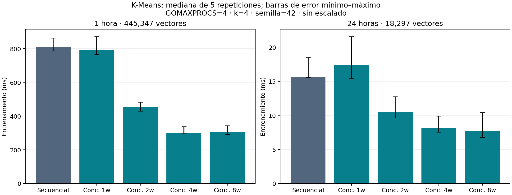

# Aporte del integrante 3: concurrencia e integración

**Responsable actual: Valentina.** Este aporte desarrolla N1, N2 y N3, originalmente asignados a Nicole en `PLAN_RAMAS_COMMITS_PR_EQUIPO.md`, después del intercambio de funciones. Se redactó a partir del informe compartido en [Drive](https://docs.google.com/document/d/1qHX9aMZwQ2rH982L1aqbDtCRjco7FozTnOzG9zyloBQ/edit) y del código y datos integrados en `develop`, commit `a01883d`. El texto siguiente reemplaza los pendientes de 3.3 a 3.5 y aporta párrafos para conclusiones y recomendaciones. No modifica ni atribuye nuevamente el trabajo previo de las otras integrantes.

## 3.3. Paralelización del cálculo en Go

### 3.3.1. Descomposición y partición del trabajo

En cada iteración de K-Means, la asignación de una observación depende de sus dos concentraciones y de los centroides vigentes. Una vez fijados estos centroides, las observaciones pueden procesarse de manera independiente. Por ello, se paralelizó la búsqueda del centroide más cercano y la acumulación de sumas y conteos por clúster.

La implementación divide las N observaciones en P = min(workers, N) rangos contiguos y semiabiertos. Cada rango recibe N div P filas y los primeros N mod P reciben una fila adicional. Esto garantiza que cada observación se procese una vez por iteración, sin solapamientos ni omisiones, y que los tamaños difieran como máximo en una fila. Para los 445 347 vectores horarios y cuatro workers, los bloques contienen 111 337, 111 337, 111 337 y 111 336 observaciones. Para los 18 297 vectores diarios, contienen 4 575, 4 574, 4 574 y 4 574.

El número de workers es configurable mediante `-workers`. Si supera el número de observaciones, se limita la cantidad efectiva a N y no se crean particiones vacías. La cobertura se comprobó para 1 240 combinaciones de tamaños y workers, además de casos conocidos y datos reales. En los ensayos de rendimiento se mantuvo GOMAXPROCS=4; este valor limita el paralelismo de ejecución de Go y es independiente del número de goroutines solicitadas.

### 3.3.2. Patrones, goroutines y canales

Se implementó partición estática con una goroutine por rango en cada iteración. Cada goroutine recorre exclusivamente su bloque, asigna etiquetas y produce acumuladores privados. No se trata de un Worker Pool persistente con una cola dinámica: las goroutines se crean para la iteración y finalizan antes de iniciar la siguiente.

En este algoritmo no se necesitan canales ni mutex. La sincronización utiliza `sync.WaitGroup`; las etiquetas se escriben en segmentos disjuntos y cada resultado parcial tiene un índice exclusivo. En cambio, el módulo existente de carga de mediciones sí emplea canales para repartir lotes y consolidar estadísticas. Se preservaron ambos diseños y se describen por separado para no atribuir al cálculo mecanismos que no utiliza.

Las goroutines comparten la memoria de un proceso y pueden ejecutarse concurrentemente. El paralelismo efectivo depende de los recursos y de GOMAXPROCS. Esta implementación no comunica computadores: los nodos, el coordinador y TCP de las secciones 3.2.5 y 3.2.6 siguen siendo un diseño distribuido propuesto.

### 3.3.3. Acumuladores locales, reducción y sincronización

Cada worker mantiene K conteos y K×2 sumas, una por característica de cada clúster. Todos consultan la misma instantánea de centroides. Las concentraciones de entrada y los centroides permanecen inmutables durante el procesamiento paralelo. Las etiquetas conservan el orden de las filas del CSV.

El coordinador espera con `WaitGroup.Wait()` a que terminen todas las particiones. Después reduce los acumuladores en orden creciente de worker y divide las sumas por los conteos para formar los nuevos centroides. Si un clúster está vacío, conserva su centroide anterior, como en la referencia. La actualización nunca se realiza con resultados parciales incompletos.

La convergencia se evalúa mediante la raíz cuadrada de la suma de los desplazamientos al cuadrado de todos los centroides. Se detiene cuando el movimiento es estrictamente menor que 0,001 o se alcanzan 100 iteraciones. Finalmente se reasignan las observaciones con los centroides definitivos y se calcula la inercia en el orden original de filas. El orden fijo de reducción permite repetir una configuración sin depender del orden de finalización de las goroutines; no convierte la suma en punto flotante en una operación asociativa.

### 3.3.4. Riesgos y costos de la estrategia

Los principales riesgos serían modificar los centroides mientras los workers los consultan, compartir acumuladores sin protección o escribir la misma etiqueta desde dos particiones. El diseño evita estas situaciones con datos de solo lectura, acumuladores privados, rangos disjuntos y una barrera antes de actualizar. El llamador debe mantener el dataset sin modificaciones durante el entrenamiento.

La validación de dimensiones, valores finitos y parámetros se realiza antes de crear goroutines. No existen canales del modelo que puedan quedar abiertos o bloquear un envío. Cada worker tiene un recorrido finito y registra su finalización con `defer wg.Done()`. Las pruebas usan límites de tiempo para detectar fallos de terminación. Se ejecutó además el detector de carreras sobre los casos pequeños y ambos periodos reales.

El costo de cálculo es aproximadamente O(I×N×K×2), con una reducción O(I×P×K×2). La memoria adicional es O(N+P×K×2), además del dataset compartido. Crear goroutines y acumuladores por iteración y esperar la barrera introduce costos. El balance por filas limita el desequilibrio de cantidad de trabajo, pero no mide diferencias de planificación o hardware. No se realizaron perfiles de caché, recolector de basura o sincronización, por lo que no se atribuyen a ellos las diferencias temporales observadas. Se conservan los límites de float64 de la referencia; no se garantiza estabilidad para magnitudes arbitrarias que provoquen desbordamiento.

### 3.3.5. Integración y equivalencia con la referencia

Ambas versiones reutilizan `Dataset`, `KMeansResult`, el lector de CSV y `initializeCentroids` del módulo `go/kmeans_secuencial`. Se conservan las características `[PM10, PM2.5]`, sin escalado, K=4, semilla 42, distancia euclidiana, tolerancia 0,001 y máximo de 100 iteraciones. El empate se resuelve a favor del primer centroide y el clúster vacío conserva su posición.

La equivalencia se verificó para 1, 2, 4 y 8 workers en cada periodo. Se exigió igualdad exacta de etiquetas, iteraciones y estado de convergencia. Para centroides e inercia se permitió una diferencia absoluta máxima de `1e-9 + 1e-9 × |referencia|`, que combina un margen cerca de cero con uno relativo para magnitudes grandes. Todos los casos reales pasaron. Como la inicialización ordenada es la misma, las identidades de los clústeres se comparan directamente; no se permutan etiquetas para ocultar diferencias.

| Periodo | Vectores | Iteraciones | Convergencia | Inercia aproximada | Asignaciones con 1, 2, 4 y 8 workers |
|---|---:|---:|---|---:|---|
| 1 hora | 445 347 | 96 | Sí | 389 845 120,224682 | Iguales a la referencia |
| 24 horas | 18 297 | 44 | Sí | 6 283 274,552233 | Iguales a la referencia |

Las pequeñas diferencias en los últimos dígitos de la inercia diaria se encuentran dentro del margen establecido. El resultado respalda estos archivos y parámetros; conjuntos cercanos a fronteras de asignación pueden ser sensibles al orden de suma y requieren su propia comprobación.

## 3.4. Evidencias de implementación y pruebas

### 3.4.1. Organización del proyecto y reproducción

La preparación mantiene el flujo EDA.ipynb → Limpieza.ipynb → Vectores.ipynb. Se reutilizaron las evidencias publicadas de Alexandra y los módulos de carga y referencia integrados previamente. El cargador `go/cargar-datos` valida las mediciones individuales y devuelve estadísticas. El emparejamiento temporal y espacial sigue siendo responsabilidad del cuaderno de vectores; no se sustituyó por una unión arbitraria de filas en Go.

El modelo consume por separado `features_1_hora.csv` o `features_24_horas.csv`. El comando común permite seleccionar periodo y modo y emite un resultado JSON con centroides iniciales y finales, conteos, inercia, iteraciones, parámetros, tiempos y hash de las etiquetas; `-labels` permite incluir el vector completo. El periodo debe declararse porque el CSV de características no contiene metadatos temporales que permitan deducirlo automáticamente.

Desde `go/kmeans_secuencial`, un ejemplo reproducible es:

```powershell
go run . -input ../../data/vectors/features_1_hora.csv -period 1_hora -mode concurrent -workers 4
```

Para la referencia se cambia únicamente `-mode sequential`. Los comandos de reproducción, exportación y pruebas completas se encuentran en `docs/pruebas-integracion.md`. Existen dos módulos Go; las pruebas se ejecutan dentro de cada uno, no desde una raíz sin `go.mod`. El script `scripts/verificar_integracion.py` coordina ambos y conserva los registros. También se verificó el código desde un clon local limpio; la revisión independiente por otra integrante permanece pendiente.

### 3.4.2. Casos de prueba y criterios de aceptación

| Caso | Entrada o escenario | Resultado esperado | Resultado obtenido | Autoría del componente / evidencia |
|---|---|---|---|---|
| Balance de preparación | Cuadernos y manifiestos publicados | Mediciones, exclusiones y vectores reconciliados | Auditoría previa conservada; no se volvió a procesar el CSV bruto | Alexandra; `results/limpieza` y `results/vectores` |
| Validación Go | Encabezados, comillas, unidades y valores inválidos | Aceptar o rechazar según contrato | PASS en pruebas existentes reejecutadas | Módulo previo de carga; `cargar-datos-normal.txt` |
| Carga completa | 1 062 897 mediciones | Conteos iguales en ambos modos | 1 062 897 aceptadas, 0 rechazadas; 598 502 PM10 y 464 395 PM2.5 | Módulo previo, ejecución de integrante 3; `carga-*-normal.txt` |
| Referencia | Datos pequeños y parámetros límite | Resultados conocidos y errores esperados | PASS | Módulo previo secuencial; `kmeans_secuencial-normal.txt` |
| Partición | 1 240 combinaciones de N y workers | Cada fila una vez; diferencia de tamaños ≤1 | PASS | Valentina, N1; `TestPartitionsCoverExactlyOnce` |
| Concurrencia | 1 y varios workers; más workers que puntos; empates y vacíos | Equivalencia y terminación | PASS | Valentina, N1; `TestConcurrentEquivalence` |
| Contratos y repetibilidad | Datos/configuración inválidos y 20 repeticiones | Rechazo, no mutación y resultados repetibles | PASS | Valentina, N1; pruebas de entradas y repetición |
| Integración | CSV → lector → modelo → JSON | Salidas comparables y rechazo de contratos inválidos | PASS | Valentina, N2; `TestCSVToBothModels`, `TestCLIRejectsInvalidContract` |
| Equivalencia real | Ambos periodos, 1/2/4/8 workers | Etiquetas e iteraciones iguales; tolerancia numérica cumplida | PASS | Valentina, N2; `TestRealPeriodsEquivalence` |
| Carreras | Todos los tests y datos reales | Sin avisos del detector | PASS en ambos módulos | Valentina, N2; logs `*-race.txt` |

Los resultados de pruebas nuevas corresponden al código Go del commit `e6294a9`. Los registros incluyen comandos, fechas UTC y entorno. Las cifras de preparación de datos se atribuyen a sus ejecuciones previas y no se presentan como una nueva ejecución del análisis original.

### 3.4.3. Ejecución de pruebas y detector de carreras

Se ejecutaron `go test -v -count=1 -timeout=300s ./...` y su variante con `-race` en ambos módulos, con `KMEANS_REAL_DATA=1` y GOMAXPROCS=4. Las pruebas finalizaron en PASS. El detector recorrió asignaciones, acumuladores, barreras y lecturas en los escenarios probados, incluidos los 445 347 y 18 297 vectores. Una ejecución sin avisos respalda estas rutas, pero no demuestra ausencia universal de carreras.

El entorno fue Windows de 64 bits con Go 1.27.2. Para el detector se utilizó CGO_ENABLED=1 y LLVM-MinGW portátil con CC=clang. Se conservaron los fallos de preparación: primero se corrigió la interpretación de una ruta de compilador con espacios mediante PATH; posteriormente se ejecutó en un entorno que permitiera al enlazador escribir el ejecutable de prueba. La exportación inicial con DuckDB presentó un error nativo; se exportó el Parquet con PyArrow, sin filtros, y se verificó su hash contra el manifiesto y sus conteos mediante ambos cargadores.

Los archivos `results/pruebas/ejecucion-normal.json` y `ejecucion-race.json` registran el estado final PASS. El directorio conserva salidas completas, intentos fallidos y procedencia. La comprobación desde un clon limpio y `go vet ./...` también se registran en `clon-limpio.txt`.

## 3.5. Resultados preliminares y rendimiento

### 3.5.1. Entorno y metodología de medición

La campaña se ejecutó el 6 de noviembre de 2026, hora de Lima, en Windows 11, procesador Intel Core i7-12650H con 10 núcleos y 16 procesadores lógicos, 16 782 184 448 bytes de memoria física (aproximadamente 15,63 GiB) y Go 1.27.2 windows/amd64. Se mantuvo GOMAXPROCS=4. El commit medido fue `d8189d3`, sin modificaciones rastreadas al iniciar la campaña; los hashes de entrada se conservaron en `entorno.json`.

Cada periodo se evaluó con la referencia y con 1, 2, 4 y 8 workers. Se realizó un calentamiento por configuración y cinco repeticiones medidas, con orden intercalado reproducible. En total se conservaron 50 mediciones y 10 calentamientos, junto con sus parámetros y resultados. Las cinco repeticiones son una decisión metodológica del equipo, no una exigencia del enunciado que se haya verificado aquí.

El tiempo de carga corresponde a `LoadCSV` del archivo de vectores. El tiempo ML comprende validación, inicialización, iteraciones, asignación final y cálculo de inercia. El total mide carga más entrenamiento; excluye compilación, arranque del proceso, metadatos y serialización. Tampoco incluye el procesamiento original ni el cargador de mediciones individuales. Se presentan medianas y rangos mínimo–máximo, manteniendo el mismo alcance al calcular speedup.

### 3.5.2. Comparación e interpretación

En todas las filas siguientes K=4 y GOMAXPROCS=4. Se cargaron 445 347 vectores para el periodo horario y 18 297 para el diario; no se cargaron 1 062 897 mediciones dentro de estos tiempos del modelo. Se obtuvieron 96 y 44 iteraciones, respectivamente, con las inercias de la sección 3.3.5.

| Periodo | Modo | Workers | Carga (s) | ML (s) | Total (s) | Speedup ML | Speedup total |
|---|---|---:|---:|---:|---:|---:|---:|
| 1_hora | sequential | 1 | 0.101664 | 0.811010 | 0.908066 | 1.000 | 1.000 |
| 1_hora | concurrent | 1 | 0.106380 | 0.790182 | 0.898700 | 1.026 | 1.010 |
| 1_hora | concurrent | 2 | 0.102094 | 0.454253 | 0.554695 | 1.785 | 1.637 |
| 1_hora | concurrent | 4 | 0.107007 | 0.301061 | 0.413036 | 2.694 | 2.199 |
| 1_hora | concurrent | 8 | 0.100554 | 0.306818 | 0.416045 | 2.643 | 2.183 |
| 24_horas | sequential | 1 | 0.003937 | 0.015612 | 0.019671 | 1.000 | 1.000 |
| 24_horas | concurrent | 1 | 0.003942 | 0.017339 | 0.021538 | 0.900 | 0.913 |
| 24_horas | concurrent | 2 | 0.003986 | 0.010493 | 0.014642 | 1.488 | 1.343 |
| 24_horas | concurrent | 4 | 0.003528 | 0.008136 | 0.011592 | 1.919 | 1.697 |
| 24_horas | concurrent | 8 | 0.004215 | 0.007688 | 0.012617 | 2.031 | 1.559 |


**Figura. Medianas y rangos de entrenamiento por configuración.**



En el periodo horario, cuatro workers redujeron la mediana de entrenamiento de 0,811010 s a 0,301061 s, un speedup de 2,694. El speedup de carga más entrenamiento fue 2,199. Ocho workers no mejoraron la mediana de entrenamiento respecto de cuatro en esta campaña; GOMAXPROCS permaneció en cuatro.

En el periodo diario, ocho workers obtuvieron la menor mediana de entrenamiento (0,007688 s), con speedup de 2,031. Sin embargo, cuatro workers presentaron un menor total mediano (0,011592 s frente a 0,012617 s). Esta diferencia muestra por qué la elección depende del alcance temporal de interés. Los rangos de las mediciones se solapan y no se plantea una superioridad universal de una configuración.

La variante concurrente con un worker fue más lenta en los datos diarios: speedup ML de 0,900 y total de 0,913. Se conserva este resultado sin ajustar tiempos. Para cuatro workers, la eficiencia definida como speedup ML / workers fue aproximadamente 0,673 en horario y 0,480 en diario; esta razón describe workers, no utilización física de CPU.

El algoritmo concurrente fusiona asignación y acumulación, mientras la referencia las ejecuta en recorridos separados. Por ello, las diferencias comparan implementaciones completas y no pueden atribuirse exclusivamente al paralelismo. No se controlaron exhaustivamente otros procesos, temperatura, frecuencia ni caché; no se realizaron perfiles para explicar causalmente esas diferencias. Las conclusiones se limitan al equipo, archivos y configuración ensayados.

## 4. Conclusiones — aporte para añadir

La implementación concurrente procesa las observaciones mediante rangos disjuntos, acumuladores privados y una barrera antes de actualizar centroides. Reutilizar el contrato y la inicialización de la referencia permitió comprobar equivalencia de asignaciones y resultados numéricos en ambos periodos reales. Las pruebas y el detector de carreras finalizaron correctamente en las rutas ensayadas.

La validación distingue las 1 062 897 mediciones limpias de los 463 644 vectores completos, separados en 445 347 horarios y 18 297 diarios. El cargador valida mediciones y el modelo consume los vectores preparados; no se confunden ambos volúmenes ni se mezclan periodos.

En esta campaña, cuatro workers ofrecieron speedup de entrenamiento de 2,694 para el periodo horario y 1,919 para el diario. La concurrencia no mejoró todas las configuraciones: un worker concurrente fue más lento en el conjunto diario. Los resultados sustentan la evaluación de esta implementación, sin demostrar todavía distribución entre computadores ni beneficios predictivos o sanitarios del agrupamiento.

## 5. Recomendaciones — aporte para añadir

Mantener los periodos separados, conservar hashes de entrada, centroides iniciales, semillas y resultados crudos, y repetir la comparación en los equipos que utilizará el grupo. Para estudiar escalabilidad, variar GOMAXPROCS y workers mediante campañas independientes y aplicar perfiles antes de atribuir costos a memoria, GC o sincronización.

Solicitar a otra integrante la reproducción y revisión de las tres ramas. Integrarlas en orden N1 → N2 → N3, porque las pruebas y mediciones dependen de la versión concurrente. En el informe general, actualizar la tabla de componentes para indicar que la carga y K-Means concurrente ya están implementados, manteniendo nodos y TCP como propuestas. Completar cualquier identificación personal con los datos verificados del equipo.

## Evidencias de consulta y reproducción

- [Diseño y contrato concurrente](kmeans-concurrente.md).
- [Integración, comandos y pruebas](pruebas-integracion.md).
- [Metodología y límites de rendimiento](rendimiento.md).
- [Mediciones crudas](../results/rendimiento/ejecucion-local/mediciones.csv).
- [Entorno y hashes](../results/rendimiento/ejecucion-local/entorno.json).
- [Procedencia de datos y fuentes consultadas](../results/pruebas/procedencia.json).
