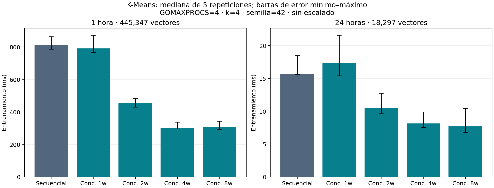

# N3 — Comparación de rendimiento

Responsable actual: Valentina (integrante 3). Se compara la referencia ya integrada con la implementación concurrente de N1, mediante el comando común de N2.

## Metodología

Se usan los CSV reales publicados: 445 347 vectores de una hora y 18 297 de 24 horas, sin mezclar periodos, replicar filas ni escalar características. Configuración común: `[PM10, PM2.5]`, distancia euclidiana, k=4, semilla=42, tolerancia=0.001, máximo de 100 iteraciones, mismo muestreo sin reemplazo y conservación del centroide de un clúster vacío. Cada JSON registra los centroides iniciales y verifica que coinciden exactamente.

Para cada periodo se evalúan secuencial y concurrente con 1, 2, 4 y 8 workers. GOMAXPROCS=4 se mantiene fijo para todos los procesos. Se compila una vez, sin instrumentación de carreras. Se conserva un calentamiento por configuración (repetición 0), excluido del resumen, seguido de cinco repeticiones medidas en un orden intercalado reproducible (semilla de orden 2026). Son 50 mediciones y 10 calentamientos conservados. No se selecciona solamente el mejor tiempo.

Cada ejecución se realiza en un proceso nuevo. El programa mide `LoadCSV`, el entrenamiento completo (validación, inicialización, iteraciones, asignación final e inercia) y el intervalo total de carga más entrenamiento. La generación adicional de metadatos, el hash de etiquetas, JSON, compilación y arranque del proceso quedan fuera. El total tampoco incluye el EDA, la limpieza, el emparejamiento de mediciones ni el cargador del CSV de 1 062 897 mediciones, cuyas evidencias están separadas en N2.

Se resumen tiempos con mediana y se conservan mínimo y máximo para visualizar dispersión. Speedup de ML = mediana secuencial ML / mediana concurrente ML; speedup total = mediana secuencial total / mediana concurrente total. La eficiencia por workers = speedup de ML / workers se almacena en JSON: no equivale a eficiencia por núcleo, especialmente con 8 workers y GOMAXPROCS=4.

## Resultados y evidencia

Consultar [la tabla de medianas](../results/rendimiento/ejecucion-local/RESUMEN.md), [los datos crudos](../results/rendimiento/ejecucion-local/mediciones.csv), [el entorno](../results/rendimiento/ejecucion-local/entorno.json) y [el resumen con rangos](../results/rendimiento/ejecucion-local/resumen.json). Cada medición conserva comando, parámetros, centroides, conteos, iteraciones, inercia y hash de etiquetas en su JSON. La versión medida y los hashes SHA-256 de los CSV se registran en el entorno.



## Límites de interpretación

Las comparaciones verifican todas las etiquetas mediante SHA-256, centroides e inercia con tolerancia absoluta 1e-9 más relativa 1e-9, e igualdad de iteraciones y convergencia. En las pruebas reales de N2 también se compararon directamente los vectores completos de etiquetas.

Los resultados describen este equipo, los archivos publicados, k=4 y esta ejecución. No son una garantía para otras máquinas, tamaños o semillas. No se controlaron exhaustivamente actividad de otros procesos, temperatura, frecuencia ni estado de caché del sistema operativo; el calentamiento no representa una carga desde disco frío. Cinco repeticiones y mínimo–máximo describen dispersión, no intervalos de confianza.

La variante concurrente fusiona asignación y acumulación en un recorrido, mientras la referencia utiliza dos recorridos. Por tanto, el speedup compara implementaciones completas: **no permite atribuir toda la mejora al paralelismo**. El caso concurrente con un worker ayuda a observar esa diferencia, pero no es una descomposición causal. La inercia y la reducción mantienen trabajo serial. No se realizaron perfiles para atribuir costos a caché, GC o barreras. Ocho workers no implican ocho ejecuciones simultáneas con GOMAXPROCS=4.

## Reproducción

Desde la raíz del repositorio, seleccionar una carpeta de salida nueva:

```powershell
python scripts/medir_kmeans.py --repetitions 5 --gomaxprocs 4 --output results/rendimiento/nueva-ejecucion
python scripts/graficar_rendimiento.py results/rendimiento/nueva-ejecucion
```

El primer script usa solo la biblioteca estándar de Python y Go. El segundo requiere Matplotlib. Las mediciones deben ejecutarse sin otros tests o benchmarks del proyecto en paralelo. Para cambiar GOMAXPROCS, realizar una campaña nueva con el mismo valor en ambas versiones y no mezclar resúmenes de campañas distintas.
